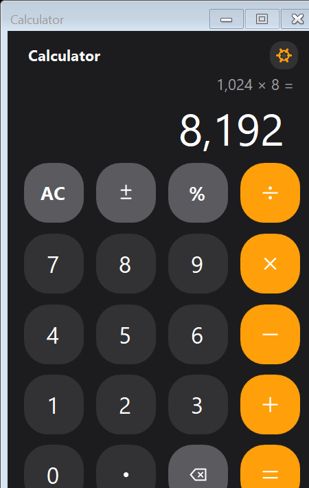
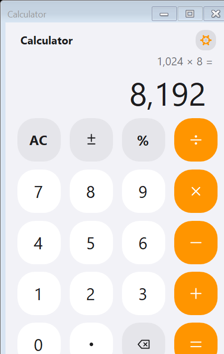
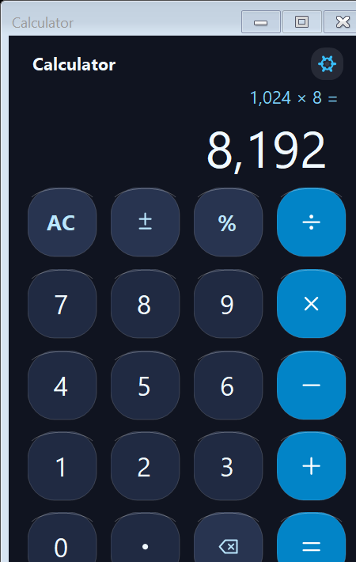
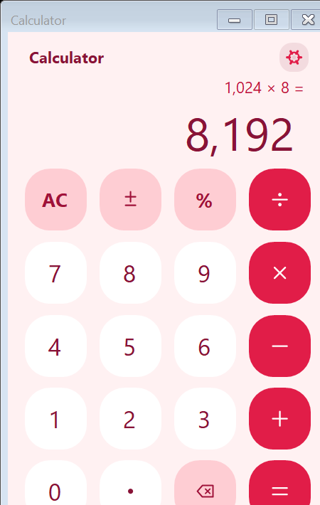
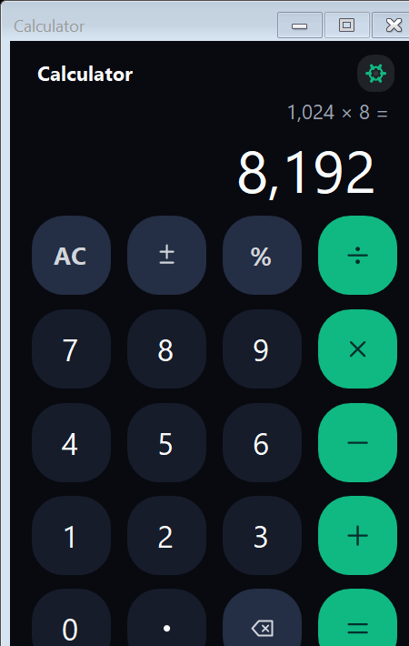
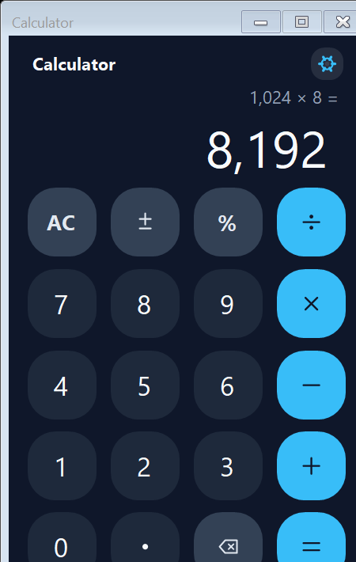
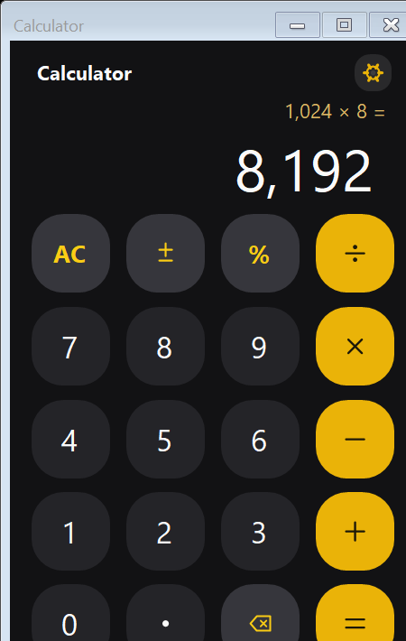
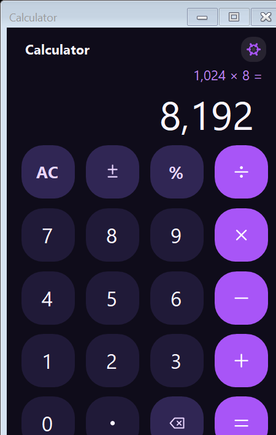
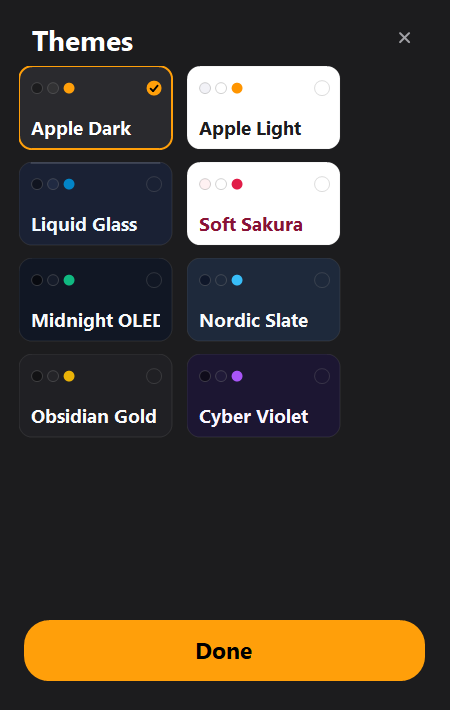

# 📱 Modern Calculator

A lightweight, elegant Windows desktop calculator built with C# and .NET 10 Windows Forms. Inspired by Apple design and VisionOS frosted glass, featuring 8 curated themes, smooth vector icons, and an in-app theme switcher.

Originally created by [@legenddohe-coder](https://github.com/legenddohe-coder/calculator) and redesigned by [@h5r5](https://github.com/h5r5).

---

## 🎨 Themes Showcase

| Apple Dark | Apple Light | Liquid Glass | Soft Sakura |
| :---: | :---: | :---: | :---: |
|  |  |  |  |

| Midnight OLED | Nordic Slate | Obsidian Gold | Cyber Violet |
| :---: | :---: | :---: | :---: |
|  |  |  |  |

<br/>

<p align="center">
  
  <br/>
  <b>Built-in In-App Theme Switcher (No popup windows)</b>
</p>

---

## ✨ Features

- **8 Handcrafted Themes**: Classic Dark, Silver Light, Liquid Glass, Sakura, OLED, Nordic, Gold, and Cyberpunk.
- **In-App Switcher**: Switch themes seamlessly inside the window with live previews.
- **Apple-Inspired Design**: Fluid circular buttons (`70×70px`) with vector math glyphs and optical alignment.
- **Windows 11 Native Sync**: Title bar color automatically matches your active theme.
- **Full Keyboard Support**: Seamless Numpad, Enter, Backspace, and Escape navigation.
- **Standalone Portable App**: Single `.exe` binary that runs everywhere with zero dependencies.

---

## ⌨️ Keyboard Shortcuts

| Key | Function |
| :--- | :--- |
| `0` – `9` / `Numpad` | Digits |
| `+` `−` `×` `÷` | Arithmetic Operators |
| `Enter` / `=` | Calculate Result |
| `Backspace` | Delete last digit |
| `Esc` | Clear (AC) / Close Themes Menu |

---

## 🚀 How to Run

### Option 1: Standalone Download
Download the latest portable `calculator.exe` directly from the [Releases](https://github.com/h5r5/calculator/releases) tab. No installation required.

### Option 2: Run from Source
Requires [.NET 10.0 SDK](https://dotnet.microsoft.com/download/dotnet/10.0):

```powershell
git clone https://github.com/h5r5/calculator.git
cd calculator
dotnet run --project calculator
```

To build a standalone single-file `.exe` locally:
```powershell
.\publish.ps1
```

---

## 👥 Credits

- **Original Project**: [@legenddohe-coder](https://github.com/legenddohe-coder/calculator)
- **Redesign & Themes**: [@h5r5](https://github.com/h5r5)
- See [CONTRIBUTORS.md](CONTRIBUTORS.md) and [CONTRIBUTING.md](CONTRIBUTING.md) for more details.
